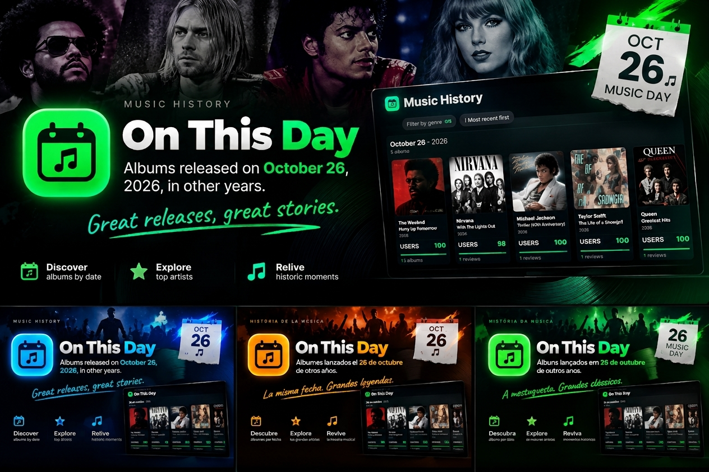

<div align="center">


# On This Day

### Discover the albums released on this day in music history — right inside Spotify.

[](README.md)
[](README.pt-BR.md)
[](README.es.md)

[](https://github.com/uWaazy/on-this-day)
[](https://spicetify.app/)
[](LICENSE)

[Features](#features) · [Installation](#installation) · [Updating](#updating) · [How to use](#how-to-use) · [Troubleshooting](#troubleshooting)

</div>

---

## Preview

<p align="center">
  
</p>

## Features

- **Albums of the day** — every album released on today's date in past years, grouped by anniversary ("12 years ago · 2014"), most popular first. You can reverse the year order with one button.
- **Real scores** — the community score comes from MusicBrainz ratings (0–100, with the vote count). Albums without votes show *unavailable*, never a made-up number.
- **Genre filters** — combine up to five genres, with live counters. Your choice is remembered.
- **Only artists I follow** — a floating button on the right turns on a view with just the artists you follow on Spotify (no login needed). On the very first launch it already starts this way; the app remembers your last choice.
- **Dynamic backgrounds** — photos of the artists behind the albums on screen, alternating with the album covers every 8 seconds (up to 6 artists at once). They follow your filters and the day.
- **Open the album in Spotify** — click a cover once to zoom it; **double-click** (or press the **Spotify** button) to open that exact album inside Spotify. If the app can't confidently find it, it opens Spotify's search on the *Albums* tab instead.
- **Year sidebar** — slides in when you move the mouse to the left edge, highlights the year you are reading and jumps to any year.
- **Update notice** — the version number at the top right turns green when a new version is available, with copy-and-paste update instructions.
- **English, Português and Español** interface.

## Installation

> Requires the Spotify desktop app and [Spicetify](https://spicetify.app/docs/getting-started) already installed.

### Recommended: one command (RAW)

Open **PowerShell** and run:

```powershell
irm https://raw.githubusercontent.com/uWaazy/on-this-day/main/install.ps1 | iex
```

It downloads the app from this repository, checks the files, enables `on-this-day` and runs `spicetify apply`. That's all.

### Manual method (if RAW doesn't work)

1. Download `manifest.json`, `index.js` and `style.css` from this repository (open each file → **Raw** → *Save as…*, or **Code → Download ZIP**).
2. Create the folder and put the three files inside it:
   - Windows: `%appdata%\spicetify\CustomApps\on-this-day`
   - macOS / Linux: `~/.config/spicetify/CustomApps/on-this-day`
3. Enable it and apply:

   ```bash
   spicetify config custom_apps on-this-day
   spicetify apply
   ```

   First time using Spicetify? Run `spicetify backup apply` once.

## Updating

- When a new version is published, the **version number at the top right of the app turns green**. Click it to see the update instructions.
- To update, run the same RAW command again (it replaces the old files), or repeat the manual method.
- To uninstall: `spicetify config custom_apps on-this-day-` then `spicetify apply`.

## How to use

| Action | What happens |
|---|---|
| **Click a cover** | Zooms the album art (Esc or click outside closes it). |
| **Double-click a cover** / **Spotify** button | Opens the album in Spotify. If it can't be identified safely, opens Spotify search on *Albums*. |
| **Filter by genre** | Pick up to 5 genres; counters update instantly. |
| **Floating person button** (right edge) | Turns *only artists I follow* on/off. |
| **↓ Newest first / ↑ Oldest first** | Reverses the order of the year sections. |
| **Mouse to the left edge** | Shows the year sidebar. |
| **PT / EN / ES button** | Changes the language. |
| **Version number** (top right) | Shows if an update exists and how to install it. |

## Troubleshooting

- **The app doesn't appear in Spotify:** make sure the folder `CustomApps/on-this-day` contains `manifest.json`, `index.js` and `style.css`, run `spicetify config custom_apps on-this-day` and `spicetify apply`, then restart Spotify.
- **The app icon is missing in the top bar:** the installed `manifest.json` must be the one from this repository (it contains the `icon` fields). Reinstall with the RAW command.
- **"Only artists I follow" shows an error:** click the button to retry; if it persists, turn it off — all albums are still shown.
- **Some covers don't load:** the app tries Cover Art Archive, then Spotify, then iTunes; a few obscure releases have no cover anywhere.
- **PowerShell blocks the script:** use the manual method, or run `Set-ExecutionPolicy -Scope Process Bypass` and try again.

## Data and privacy

Album data comes from [MusicBrainz](https://musicbrainz.org/) (published as daily files on this repository's GitHub Pages); covers from the Cover Art Archive, Spotify and iTunes; artist photos from Spotify (and Wikipedia when needed). The app talks to Spotify only through your own signed-in Spotify session (no passwords, tokens or logins are requested or stored) and checks this repository for new versions. There is no tracking or analytics. The code you run is the readable, non-minified `index.js` in this repository.

## License

Released under the **MIT License** — see [LICENSE](LICENSE).
